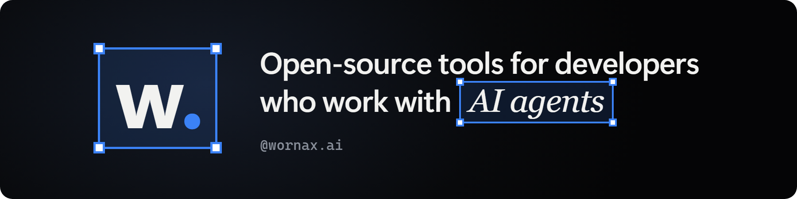

I build open-source tools for developers who work with AI agents, starting with Claude Code.

### Now

**[limit-xray](https://github.com/Wornax/limit-xray)** is a Claude Code plugin that routes every agent to the right model and effort, and shows you, with charts, where your usage limit goes.

```text
/plugin marketplace add Wornax/limit-xray
/plugin install limit-xray@limit-xray
```

Then run `/limit-xray:analyze`.

### Also here

**[infra-moderna-lab](https://github.com/Wornax/infra-moderna-lab)** is a hands-on lab, in Portuguese, that takes one app through a modern platform stack: Terraform, Terragrunt, Kubernetes, ArgoCD, Kong, Keycloak and OpenTelemetry, locally on kind or on GCP.

### Say hi

[Instagram @wornax.ai](https://www.instagram.com/wornax.ai/) · [wornax.ai@gmail.com](mailto:wornax.ai@gmail.com)
